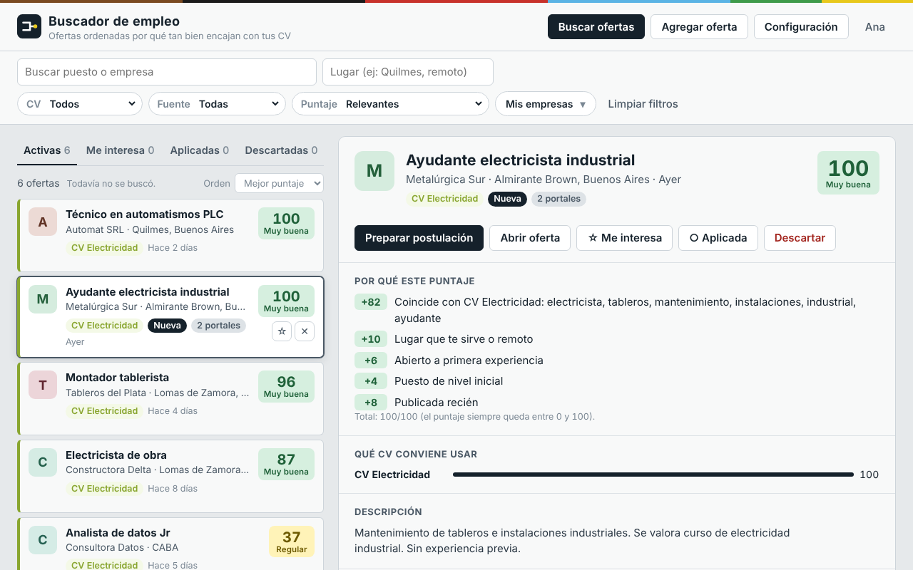
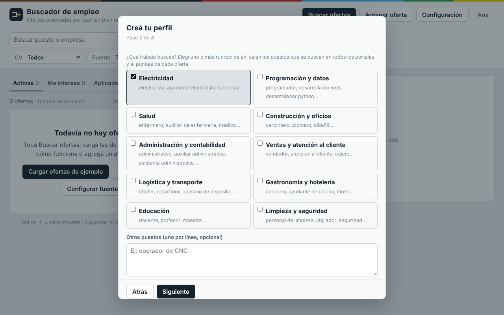
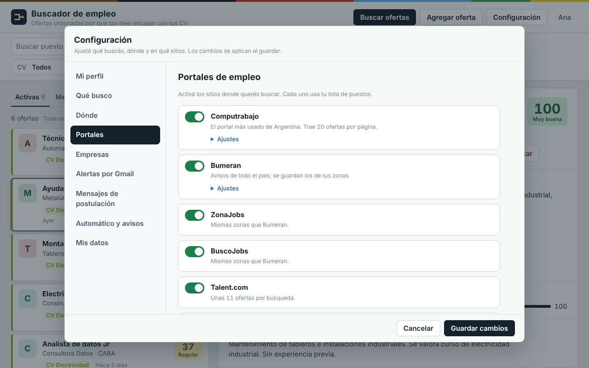
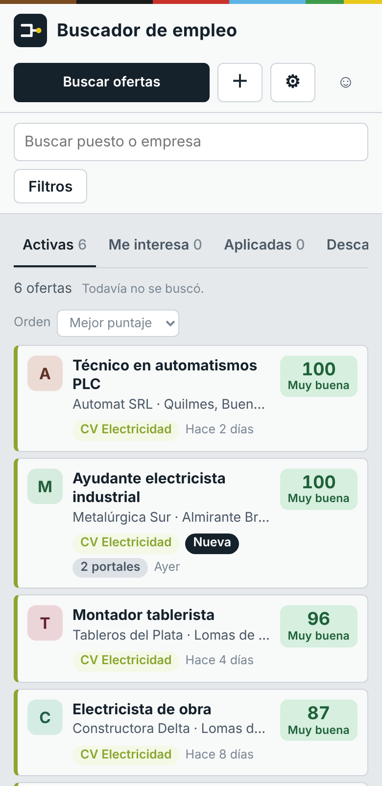

# Buscador de empleo inteligente

Un comparador de ofertas laborales que corre en tu computadora: junta las ofertas de varios portales, elimina duplicados, les pone un puntaje de 0 a 100 según **tu** perfil, te recomienda con qué CV postularte y lleva el seguimiento de cada postulación.

Funciona para **cualquier rubro** (electricidad, salud, ventas, programación, gastronomía…): al registrarte elegís tu rubro y el programa arma las búsquedas, las palabras que puntúan y las empresas a seguir.

> Proyecto personal de Matías Sosa (estudiante de Programación y Ciencia de Datos, Universidad Nacional de Guillermo Brown). Hecho en Python puro, sin frameworks ni dependencias.

## Cómo se ve



| Asistente de registro | Portales | En el celular |
|---|---|---|
|  |  |  |

## Qué hace

- **Varios países**: elegís en qué país buscás (Argentina, México, Chile, Perú, Ecuador, Panamá, Colombia, Uruguay, Costa Rica, República Dominicana, Guatemala, Bolivia y Paraguay). Se consulta Computrabajo de ese país y, donde existe, el portal del grupo Bumeran (Bumeran, Laborum, Multitrabajos, Konzerta). Los portales exclusivos de Argentina solo se usan con ese país.
- **Muchas fuentes en una sola búsqueda**: Computrabajo, Bumeran, ZonaJobs, BuscoJobs, Talent.com, Portal Empleo (Estado nacional), AMIA, Jooble (con clave), LinkedIn (opcional), trabajo remoto internacional (Remotive, Jobicy, Arbeitnow), páginas de empresas, feeds RSS y alertas de Indeed/LinkedIn leídas desde Gmail.
- **Puntaje 0-100** por oferta: coincidencia de palabras con tu rubro, zona, empresa, experiencia pedida y antigüedad. Las ofertas que no tienen nada que ver con tu perfil quedan abajo.
- **Recomienda un CV** (podés tener uno por rubro) y lee tu CV para sugerir palabras y puestos.
- **Postulación asistida**: abre la oferta en una ventana lateral y te deja el mensaje listo para copiar.
- **Seguimiento**: estado de cada postulación, resultado, fecha de seguimiento y exportación a CSV.
- **Cuentas de usuario** con datos separados por persona, asistente de registro de 4 pasos y uso desde el celular.

## Cómo levantarlo

Necesita solo Python 3.10 o más nuevo (en uso local no hay nada más que instalar; para el modo público, `pip install -r requirements.txt`).

```
git clone https://github.com/matycody/buscador-empleo.git
cd buscador-empleo
python run.py
```

Abrí http://127.0.0.1:8000, creá tu cuenta y seguí el asistente.

| Comando | Para qué |
|---|---|
| `python run.py --red` | Usarlo desde el celular en la misma WiFi |
| `python run.py --reset-password correo nueva` | Recuperar el acceso a una cuenta |
| `BL_PUBLIC=1 python run.py` | Modo servidor público (ver [DEPLOY.md](DEPLOY.md)) |

## Cómo se calcula el puntaje

Cada rubro tiene palabras con peso (por ejemplo «tablerista» pesa más que «mantenimiento»). Se suma la mejor coincidencia de tus perfiles, y después: +10 si la zona coincide, bonus por empresas que seguís, penalización por requisitos que no cumplís y ajuste por antigüedad. Si ninguna palabra de tu rubro aparece, el puntaje se limita a 10. La pantalla muestra «Relevantes» por defecto y cada oferta explica de dónde sale su puntaje.

## Cómo está hecho

- **Backend**: `http.server` + `sqlite3` + `urllib` + `html.parser`, sin dependencias externas. API JSON bajo `/api/*`.
- **Frontend**: HTML, CSS y JavaScript sin framework, pensado primero para celular (PWA instalable).
- **Multiusuario**: cada cuenta tiene su carpeta (`data/users/<id>/`) con su base, configuración y CVs. Contraseñas de Gmail y claves de API cifradas en modo público (Fernet, clave por cuenta). Confirmación de correo y recuperación de contraseña por mail (Brevo). Contraseñas con PBKDF2-SHA256, sesiones con cookie `HttpOnly`, bloqueo tras intentos fallidos y verificación de origen en cada POST.
- **Una fuente por archivo** en `app/sources/`: cada una devuelve `(ofertas, informe)`, así agregar un portal nuevo es escribir un archivo y registrarlo en `app/search.py`.

```
app/
  server.py      API y archivos estáticos
  search.py      orquesta las fuentes, progreso y búsqueda programada
  scoring.py     puntaje y explicación
  presets.py     rubros, empresas y plantillas
  cvparse.py     lectura de CV (txt, docx, odt, pdf)
  users.py       cuentas y sesiones
  db.py          ofertas y seguimiento
  sources/       un lector por portal
  static/        interfaz
```

## Fuentes y límites honestos

- Los portales cambian su HTML sin avisar: si uno deja de traer ofertas, el informe de la búsqueda lo marca en lugar de fallar en silencio.
- LinkedIn bloquea las búsquedas automáticas (error 429). Por eso está apagado por defecto: lo más estable son sus **alertas por mail**, que el programa lee desde Gmail en modo solo lectura (guía dentro de Configuración → Alertas por Gmail).
- Jooble necesita una clave gratuita (jooble.org/api/about).
- Remotive pide dar crédito y mostrar datos con 24 h de demora; Arbeitnow y Jobicy piden no abusar. Se consultan pocas veces por búsqueda.
- Los PDF escaneados (imagen) no se pueden leer.
- Todo lo que se guarda queda en tu computadora (`data/`, ignorada por git).

## Próximos pasos

- Revisión legal de los términos y la privacidad, e inscripción de la base de datos (ver DEPLOY.md).
- Más portales por país (hoy, fuera de Argentina, solo Computrabajo y el grupo Bumeran).
- Avisos automáticos de ofertas nuevas.

Más detalle de uso por pantalla en [GUIA.md](GUIA.md).
